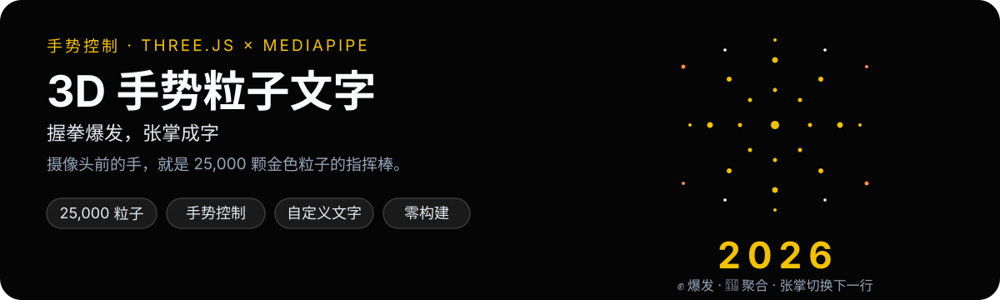
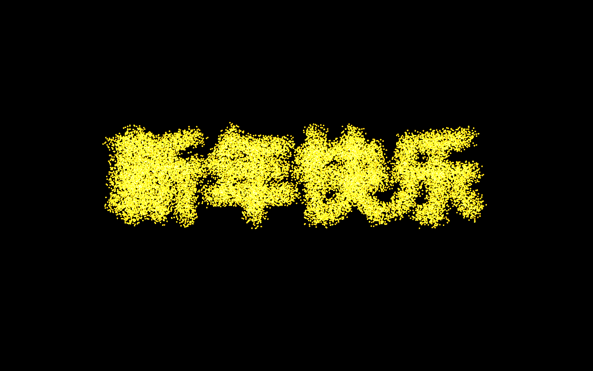
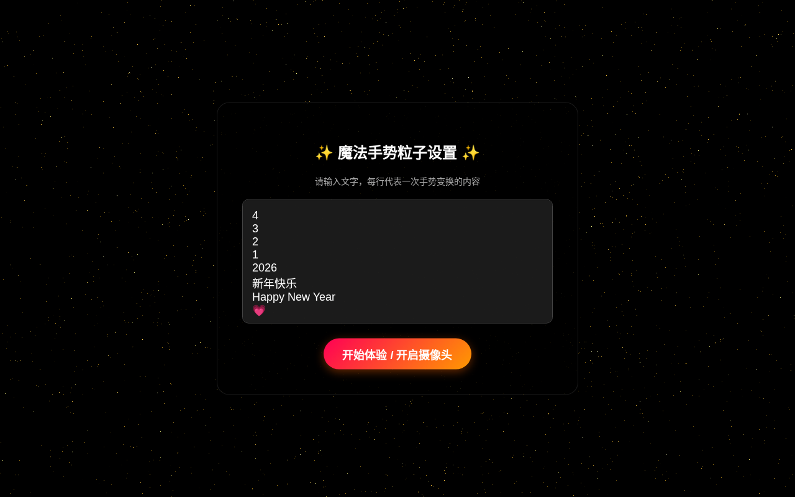

<p align="right"><a href="README.md">中文</a></p>

<p align="center">
  
</p>

<p align="center">
  <a href="https://xiaosang.cc/hand-fireworks/">▶ Try Online</a>
  ·
  <a href="https://github.com/holynova/hand_fireworks">GitHub Repository</a>
</p>

Hand Fireworks is an interactive 3D particle text effect: 25,000 golden particles float in the night, and your hand conducts them — make a fist and they burst apart; open your palm and they gather into text; each open-palm switch moves to the next line. The default set is a New Year countdown (4, 3, 2, 1, 2026, 新年快乐, Happy New Year, 💗), and the text is yours to change. Meteors and fireworks fill the background.

## Screenshots

<p align="center">
  
  
</p>

## How to Play

1. Click 「开始体验 / 开启摄像头」 ("Start / Enable Camera") and allow camera access (the page must be opened over localhost or HTTPS for the browser to grant camera access).
2. **Fist ✊**: particles burst outward.
3. **Open palm 👋**: particles gather into the current line of text; each fist-to-palm change advances to the next line.
4. **Custom text**: write one line per row in the setup panel before starting; each row is the content of one gesture change.
5. 「↺ 重新开始」 ("Restart") in the top right reloads the page back to the setup panel; a small window at the bottom left shows the live camera feed with the hand skeleton (green connectors, red joints).

## Features

- **Gesture recognition**: MediaPipe Hands, single hand, complexity 1; fist vs. open palm is judged by the average fingertip-to-wrist distance.
- **Coin-textured particles**: 25,000 particles with a custom WebGL shader and a specular highlight, so they read as golden coins; a gentle sine wobble while gathered.
- **Background**: 50 meteors plus a fireworks particle system (2,000 particles), always active in the night sky.
- **Single file, zero build**: the whole app is one `index.html`; Three.js r128 and MediaPipe load from CDN.

## Run Locally

```bash
npm start
# live-server on http://localhost:10010
```

Or open `index.html` with any static server; double-clicking the file also shows the particle effect, but the camera only works over localhost/HTTPS.

## Tech

- Three.js r128 (`three.min.js` + OrbitControls, CDN): 3D scene, particle system, auto-rotating camera; particles drift freely with no hand present and interpolate toward text target points on an open palm.
- MediaPipe Hands (CDN): 21 hand-joint detection, `maxNumHands: 1`, `modelComplexity: 1`.
- Text target points: each line is drawn on a 600×300 offscreen canvas and bright pixels are sampled to generate 3D target coordinates (about 4,000 points per line).

```
index.html      All code (835 lines): Three.js scene / particle shader / gesture callbacks / background effects
package.json    Only one live-server dev dependency; npm start runs the local server
```
