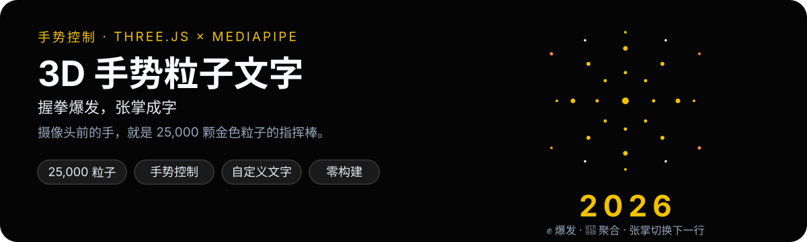
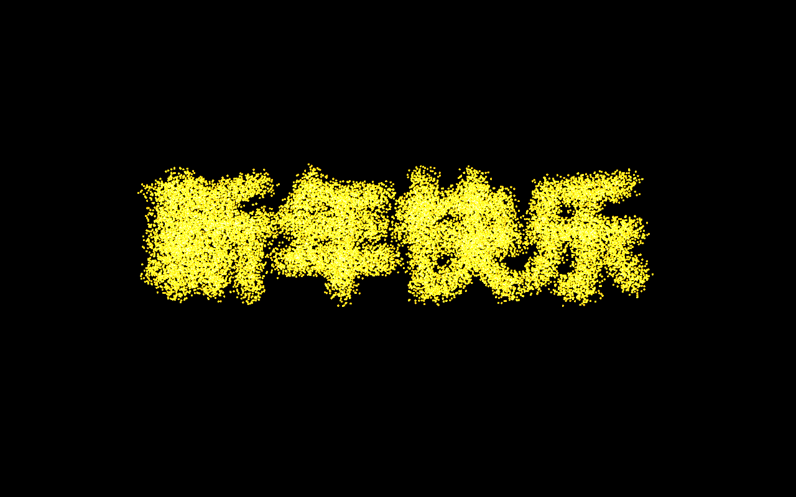
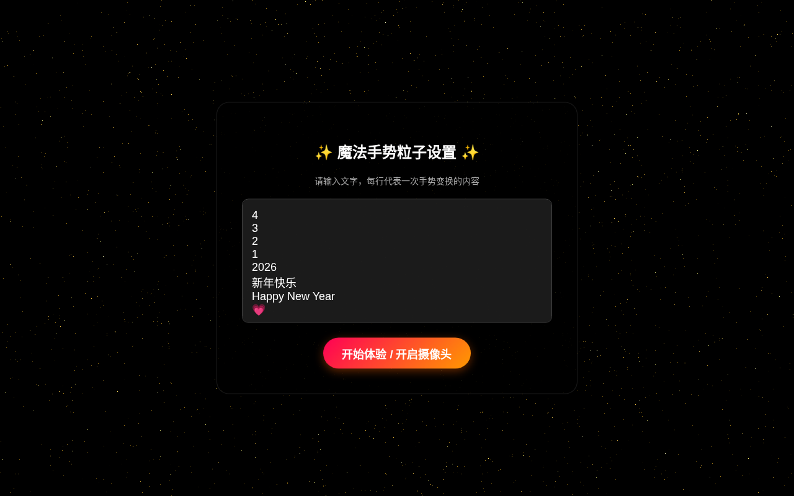

<p align="right"><a href="README.en.md">English</a></p>

<p align="center">
  
</p>

<p align="center">
  <a href="https://xiaosang.cc/hand-fireworks/">▶ 在线体验</a>
  ·
  <a href="https://github.com/holynova/hand_fireworks">GitHub 仓库</a>
</p>

3D 手势粒子文字特效：25,000 颗金色粒子悬在黑夜里，你的手就是指挥棒——握拳，粒子轰然爆发散开；张开手掌，粒子聚成文字；每次张掌切换到下一行。默认是一组新年倒数（4、3、2、1、2026、新年快乐、Happy New Year、💗），文字可自己改。背景还有流星与烟花。

## 截图

<p align="center">
  
  
</p>

## 玩法

1. 点「开始体验 / 开启摄像头」，允许摄像头权限（需在 localhost 或 HTTPS 下打开，浏览器才允许调用摄像头）。
2. **握拳 ✊**：粒子向外爆发散开。
3. **张开手掌 👋**：粒子聚合成当前行文字；每次由握拳变张掌，切换到下一行。
4. **自定义文字**：开始前在设置面板里每行写一句，每行就是一次手势变换的内容。
5. 右上角「↺ 重新开始」刷新页面回到设置面板；左下角小窗实时显示摄像头画面与手部骨架（绿色连线、红色关节点）。

## 功能

- **手势识别**：MediaPipe Hands，单手、复杂度 1；按四指指尖到手腕的平均距离判断握拳 / 张掌。
- **金币质感粒子**：25,000 颗粒子，自定义 WebGL 着色器带左上角高光，看起来像金币；聚合时带轻微正弦抖动。
- **背景特效**：50 颗流星 + 烟花粒子系统（2,000 粒），一直在夜空里活动。
- **零构建单文件**：整个应用就是一个 `index.html`，Three.js r128 与 MediaPipe 走 CDN，打开即玩。

## 本地运行

```bash
npm start
# live-server 起在 http://localhost:10010
```

或用任意静态服务器打开 `index.html`；直接双击本地文件也能看粒子效果，但摄像头需要在 localhost/HTTPS 下才能用。

## 技术

- Three.js r128（`three.min.js` + OrbitControls，CDN）：3D 场景、粒子系统、自动旋转视角；无手时粒子游离漂浮，张掌时朝文字目标点插值聚合。
- MediaPipe Hands（CDN）：手部 21 关节点检测，`maxNumHands: 1`，`modelComplexity: 1`。
- 文字目标点：把每行文字画到 600×300 离屏 Canvas 上，逐像素采样亮点生成 3D 目标坐标（约 4,000 个点）。

```
index.html      全部代码（835 行）：Three.js 场景 / 粒子着色器 / 手势回调 / 背景特效
package.json    仅一个 live-server 开发依赖，npm start 起本地服务
```
